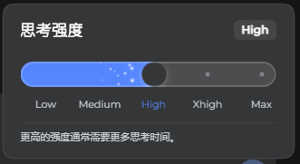
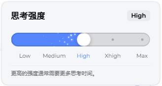

# dsh-model-picker

给 [DeepSeek Harness](https://github.com/deepseek-ai/deepseek-harness)（DSH）的输入框换一个**模型选择器**：可搜索、按 provider 分组，模型和思考档位分成两个独立控件。

DSH 自带的模型选择器是按两级菜单设计的。模型一多，找一个模型要翻两层；思考档位藏在二级菜单里，改一次要点三次。这个插件把它换成一次点开的列表：直接搜、直接选。

## 预览

深色主题：



浅色主题：



## 它做了什么

**可搜索的模型列表** — 点开即输入，按名字或 id 过滤，每个 provider 一张卡片。没有搜索词时按模型
名字排序（`V3.9` 排在 `V3.10` 前面）。卡片可以折叠，折叠状态会记住：下次打开 DSH 时，上次收起来的
provider 还是收着的。

**同一个插件的多个 provider 合成一张卡** — 比如某个插件的「大陆版 / 海外版」两个部署，以前是两张
长得差不多的卡，现在一张卡、用标签页切换，卡片头显示它们共同的名字。选中的仍是各自的完整 provider。

**部分 provider 会显示实时状态** — 支持这一点的插件（目前是 WorkBuddy）会把每个模型的登录状态、
倍率、可用性和负载发布出来：行尾显示 `0.23x` 或「免费」/「未知」，不可用时改显示「限流」「积分不足」
这类原因；行首的圆点是负载（绿=空闲、黄=轻微拥堵、红=极度拥堵），探测不出结论时是灰点（悬停显示
「未知」）。数据没有到达之前，行尾先显示「未知」占位，账户行显示「积分 加载中…」，不会先画空、半秒后
再长出来。列表打开期间每 2 秒要一次新数据，关闭就停；没有搜索词时模型按名字排序，两个部署的标签逐行
对齐。

**卡片头上还能直接看余额、直接登录、续期** — 同一个插件的两个部署并成一张卡后，每个部署标签下面带
一行账户状态：已登录显示「积分 1666.68」和一个刷新按钮，未登录显示「登录」按钮；卡片头右侧还有一个
「续期」按钮，一次续期这个插件管的全部部署。登出（或刚登录完、目录还没跟上）的部署不会从列表里消失，
它的标签和登录入口都在，正文显示「暂无可用模型」直到模型注册进来。刷新、登录、续期都调那个插件自己
发布的服务，不在这里重新实现。

**模型与思考档位分开** — 两个按钮、两个浮层，互不干扰。换模型不会顺手改掉档位，改档位也不会换模型。

**和官方选择器共用一份状态** — 不是另起炉灶。它复用 DSH 自己的 `modelDirectories` 服务，所以你在输入框里选的模型，和 `/model` 命令弹窗里看到的，永远是同一个。切换过程中（Host 还没确认时）两个入口都会显示"正在切换"。

**搜索跟官方同一套算法** — 有序子序列匹配、前缀优先，`gpt61` 也能找到 `GPT-6.1-Sol`；模型 id 同样是搜索键。

**切档位失败会告诉你** — 提示框挂在控件上方，默认收起，点开才显示原始的 `code: message`。

**档位是一条能拖的滑杆** — 轨道上是各档位的刻度，拖动时滑块跟手，松手才提交一次。滑块整个
待在轨道里面，不会压出边界；面板是紧凑尺寸，不占半个屏幕。

**档位越高，喷射越远越密** — 滑块身后会拖出一束白色方块，强度随档位变化：最低档只飘出几颗、
刚离开滑块就散掉，最高档是 60 颗、能一路撒到轨道中段。最高档还会多一层拖尾。粒子跟随档位实时
变化，拖动时也跟着滑块走。

**最高的两档有自己的颜色** — 与 Codex CLI 的做法一致，只给最上面两档上色，而不是给每一档排一条
渐变：最高档是紫色、第二高档是浅琥珀色，其余档位保持品牌蓝。颜色会同步到滑杆、面板右上角的档位
标签和输入框那一行的按钮文字，切换时是渐变而不是硬跳。

**跟着模型列表实时变** — 别的插件改了可用模型（开关模型、导入账号、探测到模型不可用……），这个列表会立刻跟着变，不用刷新页面。

**新会话显示默认模型** — 而不是空着或显示"没有可用模型"。

**子会话里自动隐藏** — 在被指派的 subagent 会话里，Host 不允许换模型，控件直接不渲染，而不是给你一个点了必失败的按钮。

## 安装

```sh
dsh plugin --profile <你的 profile> add @huai_xin/dsh-model-picker
```

装完**重启宿主**，再刷新页面。客户端代码是在页面启动时加载的，只刷新页面通常还是旧的。

也可以从本地目录装：

```sh
dsh plugin --profile <你的 profile> add /path/to/dsh-model-picker
```

不想要了就直接停用或移除这个 bundle，不会影响模型本身是否可用。

## 和官方选择器的关系

**只换界面，不换数据。** 模型列表、当前选择、切换、失效刷新——这些都还是 DSH 官方 `ui-model-selection` 的实现，本插件通过它的 `modelDirectories` 服务读取。所以：

- 你在 `/model` 命令里看到的和输入框里看到的，永远是同一个选择
- 官方插件升级后，数据层的行为会自动跟着变

有一处**已知差异**：provider 插件挂在模型名上的徽标（`conversation.input.model.label`
子槽位）在这里**不会显示**，模型名回落成纯文本。原因是子槽位声明按 key 独占，官方占用者已经
声明了它，本插件再声明会直接抛 `already declared`，整个选择器停摆——见
[AGENTS.md](AGENTS.md) 不变量 2。取舍是：能用的选择器，好过带徽标但不渲染的选择器。

本插件替换的只是那层 UI：把两级菜单换成一次点开的可搜索列表，把思考档位拆成独立控件。

## 会不会挡住别的按钮

不会。这个面板会主动请求宿主抬高输入区的层级（`data-trigger-menu`），所以聊天区右下角那个
「跳到底部」按钮不会盖在面板上面。

## 兼容性

需要 DSH `0.2.1-rc` 及以上。插件本身不认识任何具体 provider——任何 provider 插件注册的模型都会出现在列表里。

## 开发

见 [AGENTS.md](AGENTS.md)。

## License

MIT
